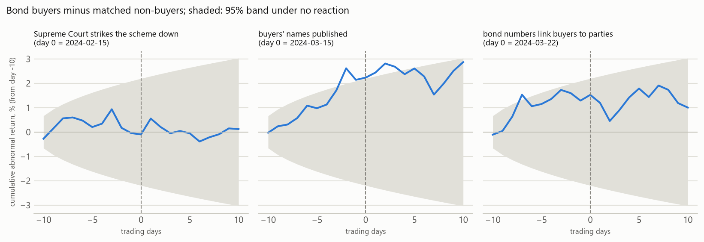

# Political Alpha Tracker

**Did Indian companies that bought electoral bonds behave differently in the stock market?**

I matched all 18,871 electoral bonds in the March 2024 disclosure (Rs 12,155.5 crore, April 2019 to
January 2024) to NSE's 2,645 listed equities, counting bonds bought through majority-owned subsidiaries.
Then I tested two things: a published finding that politically connected firms' returns lead their
peers', and whether buyers' share prices moved when their names became public. Neither shows up, and
each test reports the smallest effect it could have detected. Both tests and their decision rules were
committed before the rebuilt data were run.

[](https://github.com/KalWardin-Dronzer/Political_Alpha_Tracker/actions/workflows/tests.yml)

<picture>
  <source media="(prefers-color-scheme: dark)" srcset="results/figures/connections-dark.png">
  
</picture>

## Findings

**1. 114 listed companies bought electoral bonds, themselves or through a majority-owned subsidiary:
4,292 bonds worth Rs 3,498 crore, 28.8% of all bonds sold.** CESC (Rs 526 crore, all through three
subsidiaries), Vedanta (Rs 401 crore) and Bharti Airtel (Rs 235 crore) bought the most. The tests count the
112 that bought at least one bond of Rs 10 lakh or more. Counting only bonds a listed company bought in its
own name, 104 companies bought Rs 2,352 crore (19.4%). Every subsidiary link and every rejected match is in
[data/match_audit.csv](data/match_audit.csv) with its source; the full table is
[results/connections.csv](results/connections.csv).

**2. Bond buyers do not lead their peers.** Kim, Kim, Pantzalis & Park (Financial Analysts Journal, 2018)
report that politically connected firms' returns lead those of their unconnected peers. Here, 87 bond
buyers in nine sectors were tested against 87 size-matched non-buyers and 554 peers from the same sectors,
in four pre-declared specifications. None shows buyers leading their peers (smallest Holm-adjusted
p = 1.00), and none shows them leading by more than the size-matched non-buyers (smallest Holm-adjusted
p = 0.27). That difference is tested directly, in one regression clustered by period. At weekly lag 1 the
buyers' coefficient is +0.003, with a 95% interval of [-0.057, +0.063]; the test had 80% power to detect
0.085. Judging liquidity on 2019 traded value, instead of the panel's last year, gives the same answer.
`python cli.py study lead-lag`

<picture>
  <source media="(prefers-color-scheme: dark)" srcset="results/figures/lead-lag-dark.png">
  
</picture>

**3. Share prices did not react when the buyers were named.** The buyers' names were published on the
evening of 14 March 2024. Over the next two sessions, 103 buyers moved +0.37% relative to 103 controls
matched on sector and traded value (95% interval -0.57% to +1.31%, p = 0.44); the test could detect a move
of 1.34% with 80% power. Neither the Supreme Court's verdict striking the scheme down (15 February) nor the
release of the bond numbers that linked buyers to parties (21 March) moved them either (Holm-adjusted
p ≥ 0.65).

The figure shows more than the windows do: over the two weeks before the names came out, buyers drifted
about 3% above their controls, beyond the 95% band (the declared check for days -5 to -1 caught +1.2%,
p = 0.12). Those were weeks in which small stocks fell further than large ones (in the last week the most
traded tenth of the market lost 3.8%, the least traded half 7.8%), and the drift sits in the pairs whose
buyer trades more than its control: +3.8% over the two weeks in those 63 pairs, +0.3% in the other 40. It
looks like size the matching did not remove rather than a reaction, since the names were not yet public.
Measured against the whole market instead of matched controls, the same size effect would have passed for
a significant 2.6% gain in the week before (p < 0.001).
`python cli.py study event-study`

<picture>
  <source media="(prefers-color-scheme: dark)" srcset="results/figures/event-study-dark.png">
  
</picture>

**4. The size lead-lag is not worth trading.** Large stocks' returns lead small stocks' (Lo and MacKinlay,
1990). Holding the smaller stocks only in weeks after the 100 most traded stocks rose has a Sharpe ratio of
1.07 before costs and 0.71 after 100 round trips at 0.42% each, below 0.94 for simply holding the same
stocks. A monthly version beats buy-and-hold on Sharpe by 0.48 and earns a little more (22.7% against 21.6%
a year), but the 95% paired-bootstrap interval is [-0.12, +1.03], and it is one of four thresholds tried.
Both baskets are re-formed each period from trading known at the time. `python cli.py study leadlag-rule`

<picture>
  <source media="(prefers-color-scheme: dark)" srcset="results/figures/leadlag-rule-dark.png">
  
</picture>

**5. Factor models add nothing either.** The best of eight pre-declared factor portfolios (residual
momentum, short-term reversal, low volatility) has a deflated Sharpe ratio of 0.60 against the 36 backtests
logged, below the 0.95 bar, and its bootstrap interval includes zero. Over the longest window a 40-name
version trails random 40-name picks from the same universe by 0.03. The universe's own edge over the
Nifty Midcap 100 came from 2020 to 2022: its excess Sharpe over rolling three-year windows rose to 0.82
and then fell below zero (-0.28 and -0.20 in the last two). `python cli.py study factor`, `controls` and
`universe`

## Data quality was the hard part

Purchaser names are inconsistent: "J K CEMENT LTD.", "DR.REDDY'S LABORATORIES LTD", companies since renamed,
subsidiaries with names unlike their parent's. Names are matched after stripping corporate boilerplate,
reading a period between letters as a space and joining spaced initials; the leading word must then match
exactly and RapidFuzz's token_sort_ratio must reach 93, and a name that two listed companies share is
refused. The leading-word rule exists because a score alone cannot separate some unrelated companies:
GSL Infrastructure and GTL Infrastructure score 94. A reviewed table maps 29 spellings to a company's
CIN, and an audit file records a decision and its source for the 60 largest purchasers left unmatched and
every close name: 26 spellings or former names, 23 subsidiaries and 227 refusals.

Each rebuild has found bugs in the version before it. All are fixed and covered by tests.

November 2026, this version (the first run on the rebuilt data is kept in commit `ce5f11f`):

1. The universe held only the 1,589 of NSE's 2,645 equities that mapped to a BSE scrip code, missing
   companies such as Tech Mahindra, and only 123 had a sector label, so the lead-lag test could use 36
   buyers. It now covers NSE's full list, with sector labels for 779.
2. Matching credited Welspun India's bonds to Welspun Corp and DCM Shriram's to DCM Shriram Industries. It
   missed 80 of Dr. Reddy's 84 bonds ("DR.REDDY'S" failed the leading-word rule), renamed companies such
   as PCBL (formerly Phillips Carbon Black), and Rs 1,146 crore bought through subsidiaries.
3. The old README read "the placebo is significant and the buyers are not" as "the effect is size, not
   politics". A difference in significance is not a significant difference; the difference is now tested
   directly, and on the rebuilt data the placebo is not significant at weekly lag 1 either (p = 0.15).
4. Yahoo's price panel holds 229 daily moves beyond ±40%, twice NSE's widest band outside the derivatives
   segment: a print of +9,411% reversed on the next trading day, splits and demergers it never adjusted,
   level shifts at the turn of a year. In an equal-weight basket rebalanced daily, a print that reverses
   does not cancel out. They are now removed, with earlier prices rescaled as a split adjustment would. A
   few genuine moves go with them, such as YES Bank's and IndusInd Bank's in March 2020; the findings are
   the same with a 50% limit.
5. The universe and trading-rule studies picked stocks by traded value over the panel's last year, so
   they held the stocks that had become liquid by 2026: winners, chosen in advance. With that screen and
   the uncleaned prices the universe's Sharpe ratio was 1.37; it is 0.99 with neither, which removes most
   of its reported edge over the Midcap 100. The investable version was also compared with the index over
   a longer window than its own.

October 2026, when the repository was cut down to its research pipeline:

1. The connection graph kept only each company's last bond, which put real buyers such as Torrent Pharma
   and Glenmark in the placebo arm.
2. The database had loaded Jindal Steel and Power's 123 bonds three times.
3. The trading rule charged a full round trip on every entry and on every exit, doubling its costs.
4. Bootstrap confidence intervals were unseeded, so they changed on every run.

## How it works

```text
data/PurchaseData.csv   18,871 bonds     ─┐
data/companies.csv      2,645 listed     ─┤
data/donor_cins.csv     29 spellings     ─┼─ src/connections.py ── 114 bond buyers ─┐
data/match_audit.csv    276 decisions    ─┘                                         ├─ studies/
Yahoo Finance daily prices ─ src/data/price_store.py ───────────────────────────────┘
```

| Module | What it does |
|---|---|
| `src/data/build_companies.py` | Builds the universe from NSE's equity list and index files, with NSE's sector classification |
| `src/connections.py` | Attributes each bond to a listed company, directly or through a subsidiary, and totals them per company |
| `src/data/price_store.py` | The daily price panel: removes daily moves beyond ±40% and gives point-in-time traded value |
| `src/research/lead_lag.py` | Splits each sector into bond buyers, size-matched placebo leaders and peers |
| `src/research/event_study.py` | Matched buyer-minus-control portfolios around the 2024 disclosures |
| `src/research/factor_backtest.py` | NSE delivery costs with slippage, stationary block bootstrap, deflated Sharpe ratio and an append-only log of every backtest run |
| `src/data/delisting_registry.py` | Survivorship correction (0.28% a year) |
| `src/data/cin_resolver.py` | Resolves company names to CINs through Zaubacorp, refusing weak matches rather than guessing |
| `src/graph.py` | The connection graph, as an interactive page and as the image above |
| `studies/` | One script per study, each with its decision rules in its docstring; their outputs are in `results/` |

## Run it

```bash
python -m venv .venv
.venv\Scripts\activate            # macOS/Linux: source .venv/bin/activate
pip install -r requirements.txt
pytest -q                         # 103 tests, offline
python cli.py connections         # who bought bonds: offline, in seconds
python cli.py prices              # download daily prices from Yahoo Finance
python cli.py study lead-lag      # also: event-study, leadlag-rule, factor, controls, universe
python cli.py results             # regenerate everything in results/ (about 6 minutes)
python cli.py visualize --open    # interactive connection graph
```

Prices end on 10 September 2026 (`PRICE_END` in `src/config.py`): 1,588 symbols were downloaded then and
1,003 added on 9 November 2026. Yahoo revises its history, so a fresh download can differ slightly. The
universe study also downloads three Nifty indices from Yahoo each time it runs, and stops if it cannot.
[data/README.md](data/README.md) says where every input came from.

## Layout

```text
cli.py      single entry point
src/        data loading, bond attribution, the graph and the research code
studies/    one script per study, plus the figures
results/    committed outputs: the connections table, each study's output and the figures
data/       committed inputs
tests/      pytest suite, run by GitHub Actions on every push
```

## Limits

- Sector labels exist for 779 of the 2,645 companies, so the lead-lag test can use 87 of the 112
  connected buyers.
- The event study matches on sector and traded value, but buyers are still larger than their controls in
  61% of pairs, which shows up as a pre-publication drift in March 2024 (finding 3).
- The purchase file has no bond numbers, so it does not say which party redeemed each bond. The Election
  Commission's 21 March 2024 release does, and is not used here.
- Name matching prefers missing a buyer to inventing one, and group attribution counts only subsidiaries
  the audit documents.
- The universe is NSE's list as of November 2026, so it holds only companies still listed; the delisting
  registry's drag stands in for the rest.
- The lead-lag test's declared screen and placebo match use traded value over the panel's last year; the
  check with 2019 traded value agrees.

Research only, from public data. Not investment advice.
