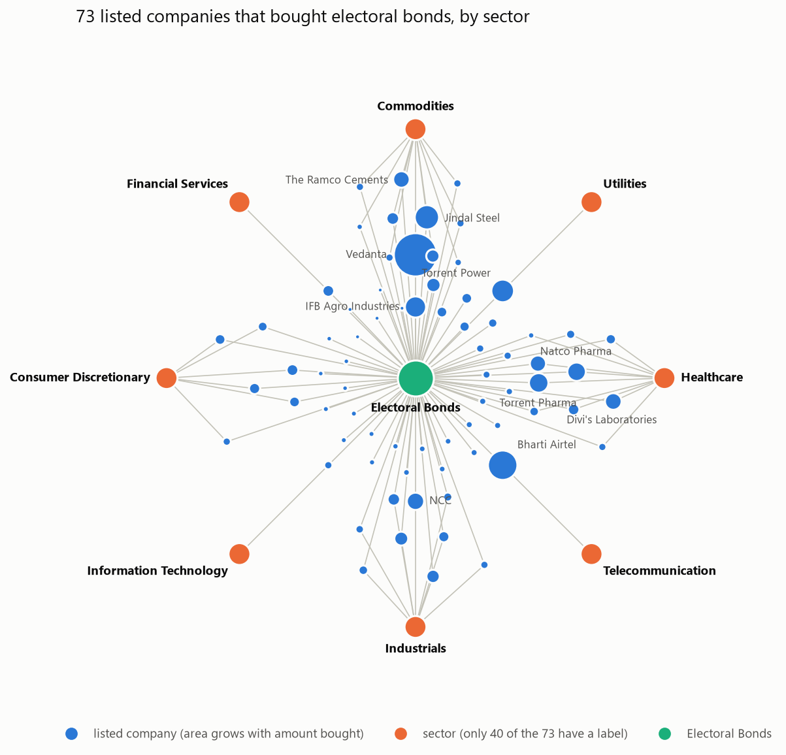
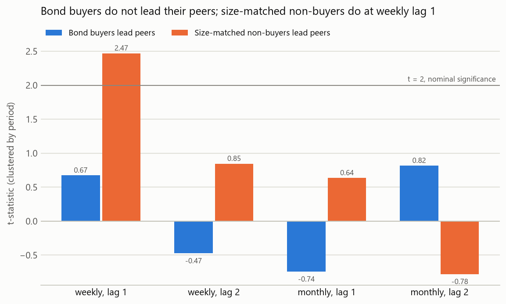
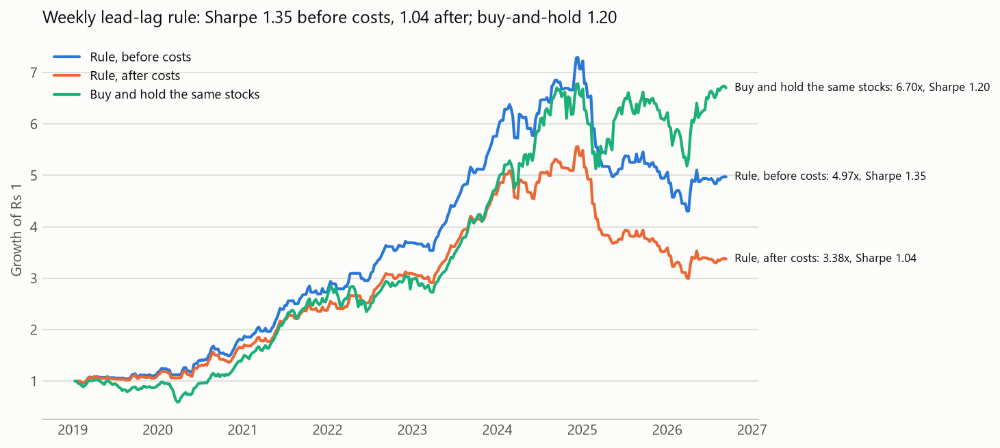

# Political Alpha Tracker

**Did Indian companies that bought electoral bonds behave differently in the stock market?**

I matched all 18,871 electoral bonds in the March 2024 disclosure (Rs 12,155 crore, April 2019 to
January 2024) to 1,589 listed companies. Then I re-tested a published finding that politically connected
firms' returns lead their peers'. On Indian data they don't. A lead-lag does exist, but it comes from size
and liquidity, and trading costs erase it.

[](https://github.com/KalWardin-Dronzer/Political_Alpha_Tracker/actions/workflows/tests.yml)

<picture>
  <source media="(prefers-color-scheme: dark)" srcset="results/figures/connections-dark.png">
  
</picture>

## Findings

**1. 73 listed companies bought electoral bonds: 2,498 bonds worth Rs 2,012 crore, 16.6% of all bonds
sold.** Vedanta (Rs 401 crore), Bharti Airtel (Rs 183 crore) and Jindal Steel (Rs 123 crore) bought the
most. The full table is [results/connections.csv](results/connections.csv).

**2. Bond buyers do not lead their peers.** Kim, Kim, Pantzalis & Park (Financial Analysts Journal, 2018)
report that politically connected firms' returns lead those of their unconnected peers. Here, 36 bond
buyers in the four sectors with enough peers were tested against size-matched non-buyers from the same
sectors. None of the four pre-declared specifications is significant, even before correcting for multiple
tests; the strongest has t = 0.82. The placebo arm is significant at weekly lag 1 (t = 2.47): large,
liquid stocks lead small ones whether or not they bought bonds. Standard errors are clustered by period.
`python cli.py study lead-lag`

<picture>
  <source media="(prefers-color-scheme: dark)" srcset="results/figures/lead-lag-dark.png">
  
</picture>

**3. The size lead-lag is not worth trading.** Holding the smaller stocks only in weeks after the 100 most
liquid stocks rose has a Sharpe ratio of 1.35 before costs and 1.04 after 92 round trips at 0.42% each,
below 1.20 for simply holding the same stocks. A monthly version beats buy-and-hold on Sharpe by 0.25,
but the 95% paired-bootstrap interval is [-0.34, +0.73] and it earns less (27.4% against 29.8% a year).
That gain comes from time spent in cash, not from the signal. `python cli.py study leadlag-rule`

<picture>
  <source media="(prefers-color-scheme: dark)" srcset="results/figures/leadlag-rule-dark.png">
  
</picture>

**4. Factor models add nothing either.** The best of eight pre-declared factor portfolios (residual
momentum, short-term reversal, low volatility) has a deflated Sharpe ratio of 0.56 against the 36
configurations tried, below the 0.95 bar. Over the longest window it trails random picks from the same
universe by 0.05. The universe's own edge over the Nifty Midcap 100 came from the 2020 rebound: its excess
Sharpe across rolling three-year windows fell from 1.34 to 0.10. `python cli.py study factor`, `controls`
and `universe`

## Data quality was the hard part

Purchaser names are inconsistent: "J K CEMENT LTD.", "DIVI S LABORATORIES", companies since renamed. Names
are matched after stripping corporate boilerplate and joining spaced initials; the leading word must then
match exactly and RapidFuzz's token_sort_ratio must reach 93. The leading-word rule exists because a score
alone cannot separate some unrelated companies: GSL Infrastructure and GTL Infrastructure score 94. A
hand-checked table maps 29 spellings the strict match misses to the company's CIN.

Simplifying this repository surfaced four bugs in the earlier version. All are fixed and covered by tests:

1. The connection graph kept only each company's last bond, so four real buyers looked unconnected,
   among them Jindal Steel (Rs 123 crore) and Torrent Pharma (Rs 77.5 crore). The lead-lag test had
   used Torrent Pharma and Glenmark as placebo "non-buyers", and JK Cement too, which the old name match
   missed. With these fixed, the placebo's t-statistic moved from 2.87 to 2.47; the verdict held.
2. The database had loaded Jindal Steel and Power's 123 bonds three times and overwritten other amounts
   on re-runs. The pipeline now reads the official CSV directly.
3. The trading rule charged a full round-trip cost on every entry and on every exit, doubling its costs.
   The after-cost Sharpe was 0.73; corrected, it is 1.04, still below buy-and-hold.
4. Bootstrap confidence intervals were unseeded, so they changed on every run.

## How it works

```text
data/PurchaseData.csv   18,871 bonds    ─┐
data/companies.csv      1,589 listed    ─┼─ src/connections.py ── 73 bond buyers ─┐
data/donor_cins.csv     29 spellings    ─┘                                        ├─ studies/
Yahoo Finance daily prices ─ src/data/price_store.py ─────────────────────────────┘
```

| Module | What it does |
|---|---|
| `src/connections.py` | Attributes each bond to a listed company and totals them per company |
| `src/research/lead_lag.py` | Splits each sector into bond buyers, size-matched placebo leaders and peers |
| `src/research/factor_backtest.py` | NSE delivery costs with slippage, stationary block bootstrap, deflated Sharpe ratio, purged and embargoed folds, and an append-only log of every configuration tried |
| `src/data/delisting_registry.py` | Survivorship correction (0.45% a year) |
| `src/data/cin_resolver.py` | Resolves company names to CINs through Zaubacorp and refuses weak matches; on 20 known CINs it found 16 and got none wrong |
| `src/graph.py` | The connection graph, as an interactive page and as the image above |
| `studies/` | One script per study; their outputs are in `results/` |

## Run it

```bash
python -m venv .venv
.venv\Scripts\activate            # macOS/Linux: source .venv/bin/activate
pip install -r requirements.txt
pytest -q                         # 72 tests, offline
python cli.py connections         # who bought bonds: offline, in seconds
python cli.py prices              # download daily prices from Yahoo Finance
python cli.py study lead-lag      # also: leadlag-rule, factor, controls, universe
python cli.py results             # regenerate everything in results/ (about 10 minutes)
python cli.py visualize --open    # interactive connection graph
```

The committed results used prices downloaded on 10 September 2026. A fresh download covers more days, so
its numbers will differ slightly. [data/README.md](data/README.md) says where every input came from.

## Layout

```text
cli.py      single entry point
src/        data loading, bond attribution, the graph and the research code
studies/    one script per study, plus the figures
results/    committed outputs: the connections table, each study's output and the figures
data/       committed inputs
tests/      pytest suite, run by GitHub Actions on every push
```

## Limits

- Sector labels exist for 123 of the 1,589 companies, so the lead-lag test can use 36 of the 73 buyers.
- The disclosure names buyers, not the parties that redeemed their bonds.
- Name matching prefers missing a buyer to inventing one.

Research only, from public data. Not investment advice.
